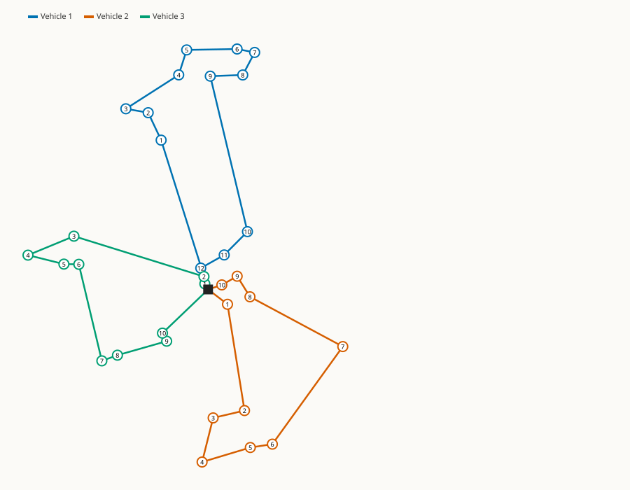

# PantryRoute

**Delivery route planner for food pantries that run home deliveries with volunteer drivers.** Give it a CSV of households (address coordinates, boxes needed, when someone is home) plus how many drivers and how much each car holds. It plans who drives where, in what order and when, and prints a sheet each driver can follow.

[](https://github.com/yashchhabra57/pantryroute/actions/workflows/ci.yml)



## The problem

Pantries that deliver to seniors, people with disabilities, and families without cars usually plan routes by hand on a map. Some households are only home in a narrow window. Cars hold a limited number of boxes. Volunteers have a fixed shift. Hand-planned routes miss windows, overload cars, and send drivers back and forth across town.

Mathematically this is the **capacitated vehicle routing problem with time windows (CVRPTW)**, which is NP-hard: there's no known fast way to find the perfect answer. PantryRoute uses the same family of heuristics that commercial routing tools use, and finds good plans in milliseconds.

## What it does

```text
$ pantryroute solve examples/twin-ports-saturday.csv --vehicles 4 --capacity 30 \
    --manifest manifest.txt --svg routes.svg --json routes.json
Stops: 32  Vehicles: 4 x 30 units
Savings construction: 79.0 km, 3 vehicles, 0 unserved
After local search:   75.8 km, 3 vehicles, 0 unserved  (4.1% shorter)
Moves: 3 2-opt, 1 relocate, 0 or-opt, 0 swap, 0 cross in 2 rounds, 0.60 ms
  Vehicle 1: 12 stops, 29/30 units, 29.4 km, 10:47-12:38
  Vehicle 2: 10 stops, 28/30 units, 24.8 km, 08:40-10:12
  Vehicle 3: 10 stops, 27/30 units, 21.6 km, 10:24-12:23
```

- **`check`** validates a stops file and reports every error with its line number.
- **`solve`** plans the routes and can write:
  - a **JSON plan** for other tools;
  - **printable driver manifests** (arrival time, boxes to drop, window, notes);
  - an **SVG route map**.
- **Leaves on time, not early.** Vans leave the depot as late as the time windows allow. That's why Vehicle 1 departs at 10:47 instead of 08:30 followed by two hours of waiting outside a house.
- **Scriptable exit codes:** `0` ok, `2` invalid input, `3` some stops couldn't be scheduled, `64` bad arguments.

## How it works


1. **Distances:** the great-circle (haversine) distance between coordinates, multiplied by a road factor (1.3 by default), because roads aren't straight lines. Travel time is distance ÷ speed.
2. **Construction:** Clarke-Wright savings starts with one route per household, then merges the pairs of routes that save the most distance, as long as the merged route still respects capacity, every time window, and the end of the shift.
3. **Fleet repair:** if construction used more routes than there are drivers, the smallest routes are dissolved and their stops are moved into others using cheapest feasible insertion.
4. **Local search** keeps applying improving moves until none is left:

   | Move | What it does |
   |---|---|
   | **2-opt** | reverses a section of one route to undo crossings |
   | **relocate** | moves one stop to a better spot |
   | **or-opt** | moves a chain of 2–3 consecutive stops |
   | **swap** | exchanges stops between two routes |
   | **2-opt\*** | exchanges the tails of two routes |

   Each move is first scored in O(1) from the distance matrix, and is only simulated against time windows if it would actually help.
5. **Reinsertion:** stops that couldn't be placed get another chance once the routes are tighter.

Every plan goes through an independent checker (`validate_solution`): every stop is either in exactly one route or marked unserved, no route is infeasible, and the fleet size is respected.

## Results

`pantryroute_bench` on random synthetic days around Superior, WI (median of 5 seeds, Release build):

| stops | vehicles | median solve | construction km | final km | improvement | valid |
|---:|---:|---:|---:|---:|---:|:---:|
| 25 | 2 | 0.13 ms | 244.2 | 220.4 | 9.7% | yes |
| 50 | 5 | 0.37 ms | 335.5 | 326.9 | 2.5% | yes |
| 100 | 10 | 1.43 ms | 536.6 | 526.4 | 1.9% | yes |
| 200 | 20 | 8.54 ms | 896.2 | 881.8 | 1.6% | yes |

CI runs this benchmark with a time budget, so a performance regression fails the build.

## Engineering notes

- **Modern C++20, no runtime dependencies.** The CSV parser (RFC 4180, quoted fields, line-numbered errors), JSON writer, SVG renderer and CLI are all hand-written. Catch2 is used for tests only, fetched by CMake.
- **Strict compiler warnings:** `-Wall -Wextra -Wpedantic -Wshadow -Wconversion -Wsign-conversion -Wold-style-cast -Werror`. CI builds with both GCC and Clang, plus a Debug build with AddressSanitizer and UndefinedBehaviorSanitizer, and runs cppcheck.
- **Tested with properties, not just examples.** Of the 67 test cases, several run on many random instances and check invariants: every plan is valid, local search never makes a plan longer, the solver is deterministic, and search reaches a fixed point.
- **Departure timing** uses forward time slack (Savelsbergh, 1992) to compute how late a vehicle can leave without missing a window.
- **Deterministic:** ties are broken by node ID, so the same input always gives the same plan on every platform.
- **Fast inner loop:** `route_feasible` is an allocation-free check, separate from the full simulation that records a schedule.

## Build and run

Requirements: CMake 3.24+, a C++20 compiler (GCC 12+, Clang 16+, or MSVC 19.3+), and optionally Ninja.

```bash
cmake -S . -B build -G Ninja -DCMAKE_BUILD_TYPE=Release
cmake --build build
ctest --test-dir build --output-on-failure

./build/pantryroute check examples/twin-ports-saturday.csv
./build/pantryroute solve examples/twin-ports-saturday.csv --vehicles 4 --capacity 30 --manifest manifest.txt
./build/pantryroute_bench --sizes 25,50,100,200 --seeds 5
```

On Windows with MinGW, the executables are linked statically to avoid picking up a mismatched `libstdc++` DLL.

### Stops file format

```csv
id,kind,name,lat,lon,demand,open,close,service,notes
DEPOT,depot,Twin Ports Community Pantry (sample),46.7208,-92.1041,,08:30,15:30,,"Load at dock B"
H01,stop,Hammond St household (North End),46.72483,-92.09121,2,09:00,12:00,8,Back entrance
```

Required: `id`, `lat`, `lon`. Optional: `kind` (`depot` or `stop`; exactly one depot), `name`, `demand` (boxes), `open`/`close` (`HH:MM`, the window for starting service), `service` (minutes at the door), `notes`.

## Project layout

```
include/pantryroute/   public headers (model, route, savings, insertion, local_search, solver, ...)
src/                   implementations
app/main.cpp           CLI entry point
bench/bench_main.cpp   benchmark with optional time budget
tests/                 Catch2 unit and property tests
examples/              sample delivery day (synthetic households)
```

## Limitations

- **Straight-line distances.** Travel time is haversine × a road factor at a constant speed. It ignores the real road network, one-way streets, bridges and traffic. The next step is a real distance matrix from OSRM or a routing API.
- **Heuristic, not optimal.** Savings plus local search gives good plans fast, but there's no optimality guarantee or lower bound. Metaheuristics (simulated annealing, ruin-and-recreate) would close more of the gap on large instances.
- **One depot, identical vehicles, one window per stop.**
- **Sample data is synthetic.** Household names, demands and windows are made up; the coordinates are spread around Duluth–Superior for realism.
- **No geocoding.** Stops need latitude/longitude; it doesn't convert street addresses yet.

## Roadmap

- Road-network distances via OSRM
- Address geocoding
- Mixed vehicle sizes and multiple time windows per stop
- A small web front end for uploading a CSV and printing manifests

## License

MIT
